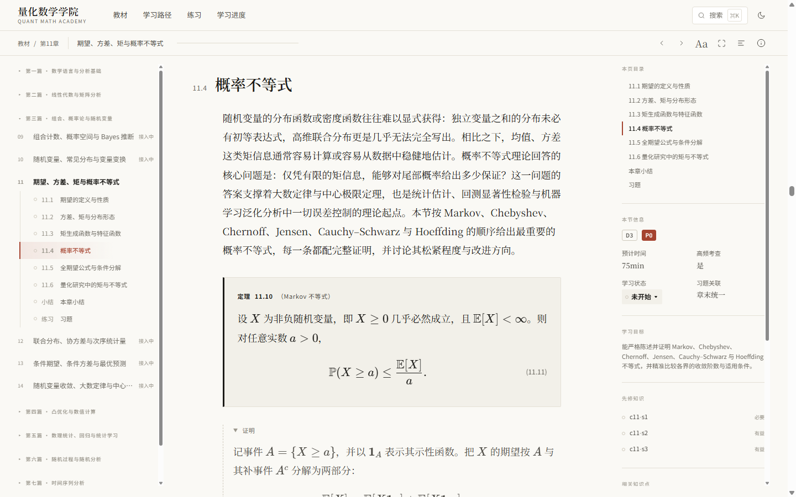
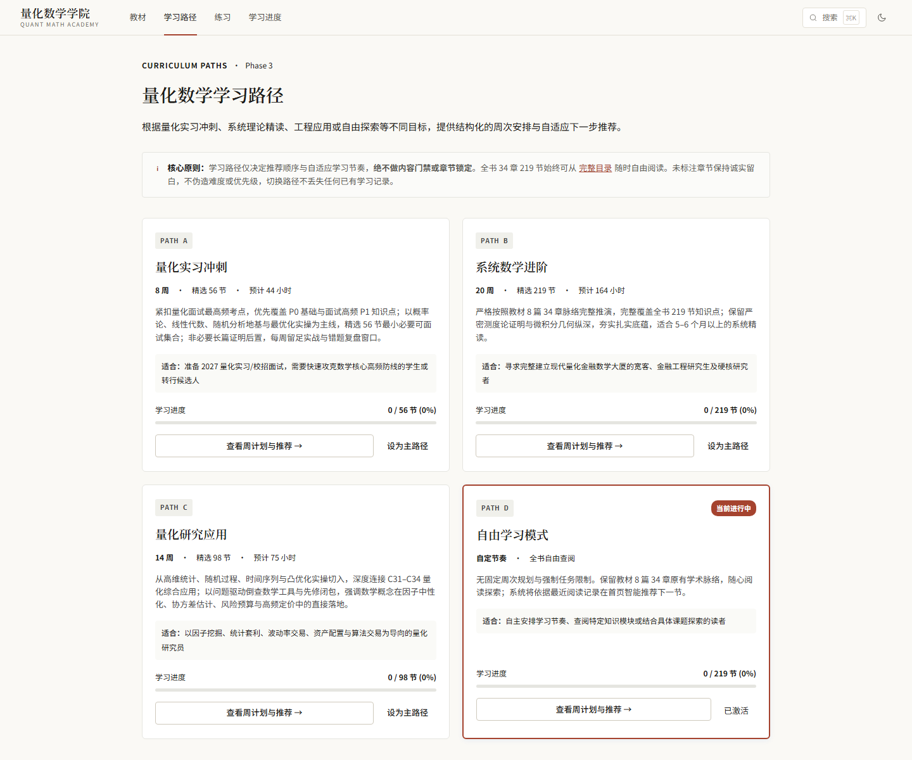
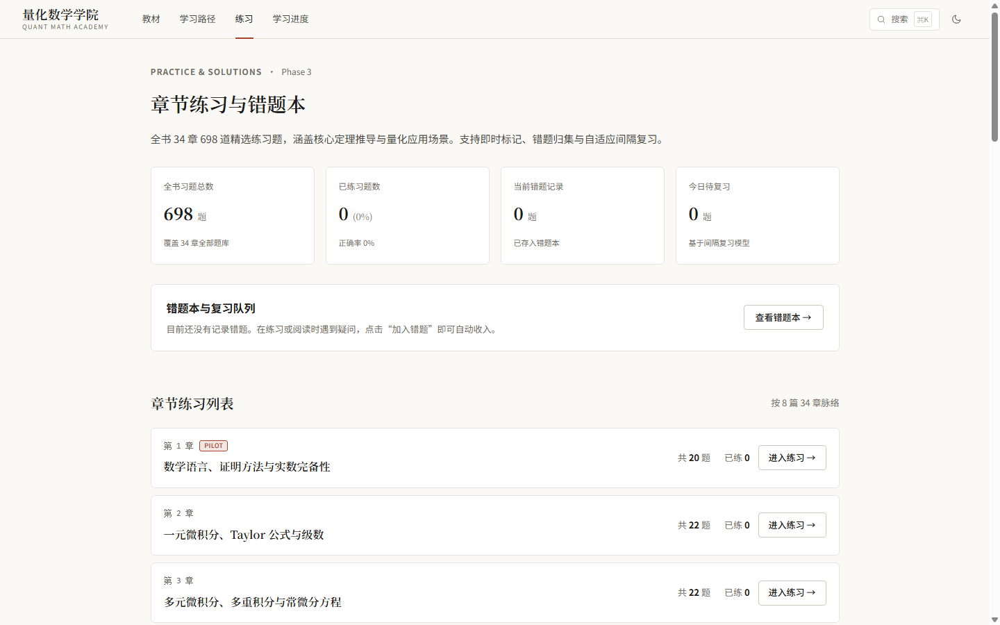
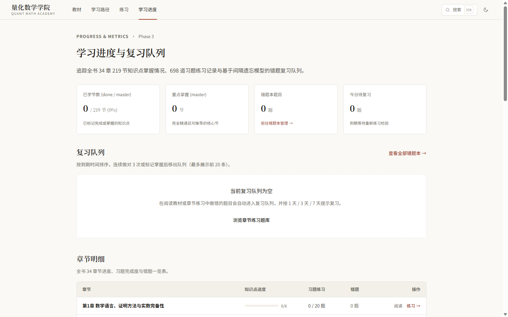

# Quant Math Academy · 量化数学学院

把 1,964 页中文量化数学教材变成可读、可搜、可练、可复习的静态学习站。

> 代码 MIT；教材内容保留所有权利，详见 [CONTENT_NOTICE.md](CONTENT_NOTICE.md)。


## 功能

- **三栏数学阅读**：构建期 KaTeX 预渲染、定理/定义/例题/证明层级、公式复制、深链锚点。
- **全书检索**：2,504 个文档（节、环境、习题、解析）；中文别名、类型/章/难度/优先级筛选、高亮。
- **知识关系图**：219 个节点、558 条先修边、446 条相关边、0 环；可追溯到章节与公式。
- **D/P 标注**：34 章 / 219 节全部覆盖；人工策展，保留 rationale、先修、关键公式、复核状态。
- **学习路径**：A 实习冲刺 56 节 / B 系统进阶 219 节 / C 研究应用 98 节 / D 自由；只改推荐，不锁内容。
- **练习与错题**：章末 698 道习题；标记做对/错题、错题本、1/3/7 天间隔复习、进度页。
- **学习状态**：未开始/学习中/已学习/已掌握/待复习；本地持久化。
- **笔记与数据**：节笔记、公式纯文本、导出/导入/清空；数据只存本机。
- **阅读偏好**：主题、字号、版式宽度、行距、专注模式、证明默认折叠。
- **响应式与打印**：390–1440 无横向溢出；A4 打印样式隐藏导航、黑白正文、公式防裁切。

| 阅读 | 路径 |
|---|---|
|  |  |

| 练习 | 进度 |
|---|---|
|  |  |

## 技术栈

- Vite + React 18 + TypeScript + React Router 7
- 构建期 `marked` + KaTeX 预渲染；客户端不跑 Markdown/KaTeX
- 无后端；localStorage 单存储 `qma:store:v1`
- 路由级代码拆分；首屏 JS gzip ≈75KB
- 测试：110 Web + 58 内容；`npm audit` 0

## 快速开始

要求 Node.js 20+。

```bash
npm ci
npm run content:build
npm --prefix web ci
npm --prefix web run dev
```

构建静态站点：

```bash
npm --prefix web run build
# 产物：web/dist
```

内容管线：

```bash
npm run content:build      # 解析/渲染/拆分/搜索/图
npm run content:validate   # 结构硬闸门
npm run metadata:validate  # D/P 元数据校验
npm run test:content
```

## 目录

```
src/                 教材 Markdown（正文/解答；内容版权保留）
content/             元数据、路径、生成物（generated 不提交）
tools/content/       解析、渲染、搜索、图谱、路径、校验
web/                 React 前端
docs/                PRD、架构、设计、任务书、验收报告
.github/workflows/   GitHub Pages 部署
```

## 部署（GitHub Pages）

`BASE_URL` 会写入 Vite 的 `base`。仓库名不是 `quant-math-academy` 时请改 workflow：

```bash
BASE_URL=/<repo-name>/ npm --prefix web run build
cp web/dist/index.html web/dist/404.html   # SPA fallback
```

已部署：**https://wwc76934-cyber.github.io/quant-math-academy/**

工作流见 `.github/workflows/deploy.yml`；详细步骤见 [docs/DEPLOY_GITHUB_PAGES.md](docs/DEPLOY_GITHUB_PAGES.md)。

## 许可

| 范围 | 许可 |
|---|---|
| 代码、工具链、前端 | **MIT**，见 [LICENSE](LICENSE) |
| 教材正文、解答、习题、生成内容 | **All rights reserved**，见 [CONTENT_NOTICE.md](CONTENT_NOTICE.md) |

第三方依赖许可见 [THIRD_PARTY_NOTICES.md](THIRD_PARTY_NOTICES.md) 与 [docs/OPEN_SOURCE_READINESS.md](docs/OPEN_SOURCE_READINESS.md)。

## 已知限制

- 全书 D/P 已覆盖 219/219；P0 56.6%、P1 33.3%、P2 9.6%、P3 0.5%，优先级仍可校正。
- 4 个 1.05–1.19MB 单节 DOM 较大（8.7–9.5 万节点）；未拆分，待低端真机验证。
- 公式收藏/分步推导/可视化未交付。
- 打印仅 PDF smoke；无障碍未做完整屏幕阅读器实测。
- 未做 1,964 页逐字校勘；已完成结构闸门、公式渲染、30 项抽查与 D/P 复核。

## 参与

- [CONTRIBUTING.md](CONTRIBUTING.md)：开发、测试、内容与许可边界
- [SECURITY.md](SECURITY.md)：漏洞报告与支持范围
- [CONTENT_NOTICE.md](CONTENT_NOTICE.md)：正文版权

## 设计文档

- [PRD](docs/product/PRD.md)
- [信息架构](docs/product/INFORMATION_ARCHITECTURE.md)
- [技术架构](docs/architecture/TECH_ARCHITECTURE.md)
- [内容模型](docs/architecture/CONTENT_MODEL.md)
- [设计系统](docs/design/DESIGN_SYSTEM.md)
- [路线图](docs/ROADMAP.md)
- [RC1 审计](docs/audit/RC1.md)
